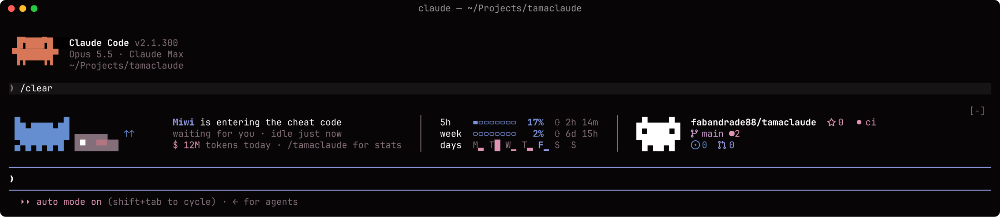
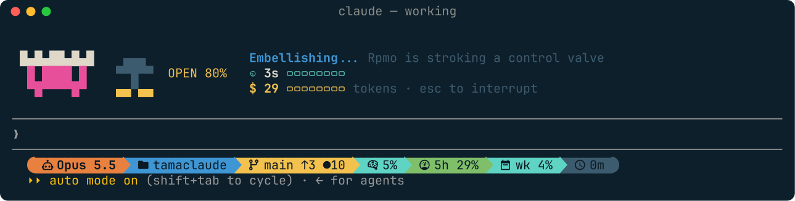
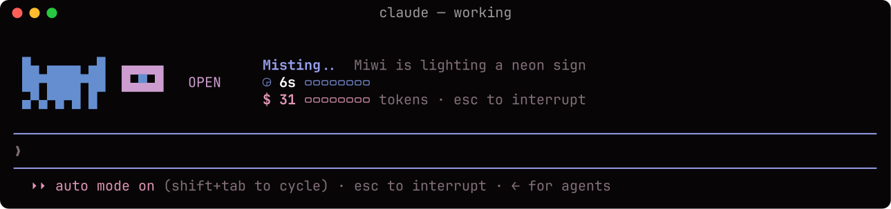
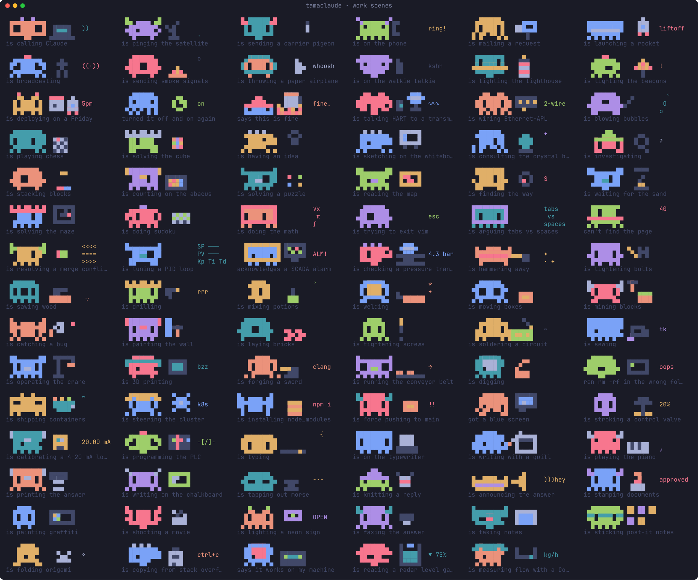
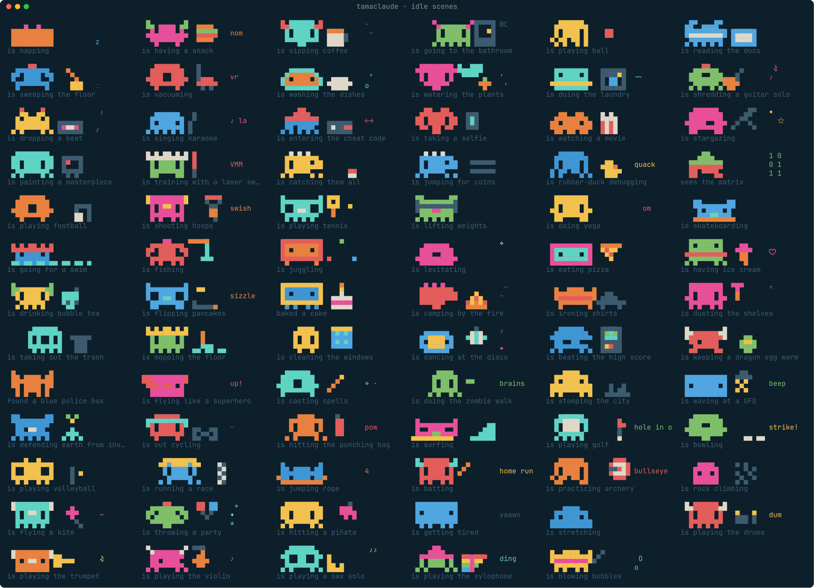
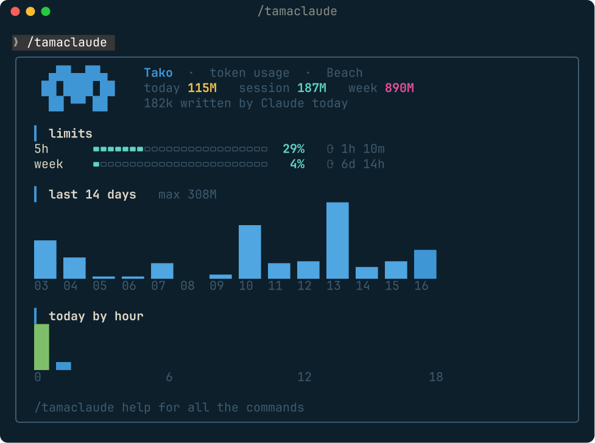
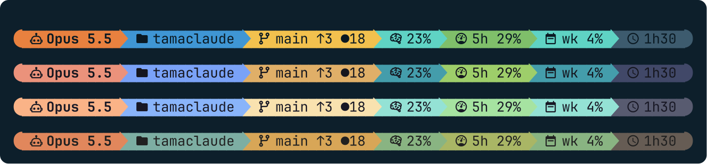
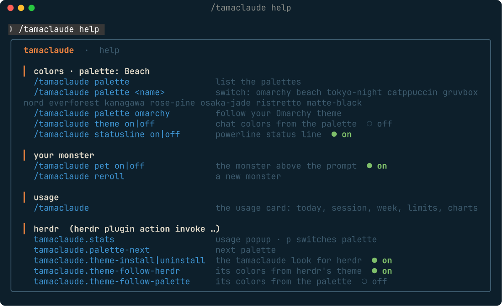
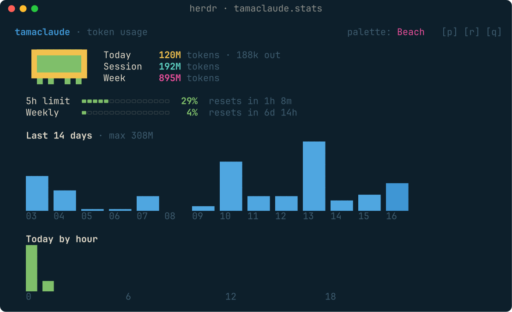

# tamaclaude

[](https://github.com/fabandrade88/tamaclaude/releases)
[](LICENSE)


A tiny pixel monster that lives in your terminal while you work with Claude Code.
It acts out what Claude is doing, hangs out with you between turns, and keeps an
eye on your token usage and your GitHub or GitLab repo.



**38** monster bodies × **7** kinds of legs · **77** idle scenes · **91** work
scenes · **12** palettes · GitHub and GitLab · zero dependencies

tamaclaude comes in two pieces that work on their own or together:

| | For | What you get |
| --- | --- | --- |
| [**Claude Code mod**](#claude-code) | everyone using Claude Code in a terminal | the monster, the usage card, palettes, the powerline status line |
| [**herdr plugin**](#herdr) | people running their agents in [herdr](https://herdr.dev) | a usage popup and a status area for herdr's tab bar |

Both share one palette and one set of numbers: switch the palette on one side
and the other follows.

---

## Claude Code

### Your monster, while Claude works

The usual `✻ Thinking… (12s · ↓ 1.2k tokens)` line becomes your monster acting
out the turn, with the time and the tokens as bars.




- **The scene follows what Claude does**, a new one every 15 seconds:
  - calling the API — laptop, satellite dish, paper airplane, lighthouse…
  - thinking — chess, Rubik's cube, crystal ball, maze, abacus…
  - using tools — hammer, saw, pickaxe, welding, 3D printer, crane…
  - writing the answer — keyboard, typewriter, quill, piano, neon sign…
- **IT life**: "this is fine", deploying on a Friday, trying to exit vim, force
  pushing to main, a merge conflict, a blue screen, installing node_modules…
- **The plant floor**: talking HART to a transmitter, wiring Ethernet-APL, a
  radar level gauge, a Coriolis meter, a control valve, tuning a PID loop,
  calibrating a 4-20 mA loop, programming the PLC, a SCADA alarm…
- **Time** fills a bar every minute and adds a `●` per minute; **tokens** fill a
  bar every 10k and add a `$` per 10k.



### Your monster, while Claude waits for you

Between turns the monster lives above the prompt and does its own thing, a new
scene every 40 seconds: naps, eats pizza, does the laundry, throws a party, plays
the drums, trains with a laser sword, hatches a dragon egg, plays football, gets
tired and yawns, goes to the bathroom…



Next to it, two columns (the second goes first on a narrow terminal):

- **Usage** — your 5-hour and weekly limits as bars with the time until they
  reset, this week's tokens per day and today's total.
- **Your repo** — an octocat on GitHub, a fox on GitLab (gitlab.com or your own
  instance): stars, last CI run or pipeline, branch, commits ahead/behind,
  changed files, version, open issues and pull/merge requests. Uses `gh` or
  `glab` when signed in, the public API otherwise.

Every session gets its own monster; `/tamaclaude reroll` draws another.

### The usage card

`/tamaclaude` prints a card in the chat: today, the current 5-hour session and
the week, your limits, the last 14 days and today by hour.



Numbers come from Claude Code's own transcripts in `~/.claude/projects` (each API
response counted once) and the limit readings Claude Code receives (Pro and Max
plans). Nothing leaves your machine.

### Powerline status line

`/tamaclaude statusline on` turns Claude Code's status line into oh-my-posh style
segments: model, folder, git branch, context, the 5-hour and weekly limits and
the session's time. The model leads in orange; limits turn orange and red as
they fill. `off` puts yours back.



### Palettes and the chat theme

Everything is drawn in one palette. **`beach`** is tamaclaude's own (Omarchy's
Beach: ocean dusk, terracotta, palm green, seafoam, bougainvillea);
**`omarchy`** follows your active [Omarchy](https://omarchy.org) theme; and
there are `tokyo-night`, `catppuccin`, `gruvbox`, `nord`, `everforest`,
`kanagawa`, `rose-pine`, `osaka-jade`, `ristretto` and `matte-black`.

`/tamaclaude theme on` colors the chat itself with the palette, mapped the way
Omarchy themes Claude Code. `off` goes back to your theme.

### Commands

`/tamaclaude help` shows them all, with what is on:



| Command | |
| --- | --- |
| `/tamaclaude` | The usage card |
| `/tamaclaude help` | Every command, and which ones are on |
| `/tamaclaude palette [name]` | List the palettes, or switch |
| `/tamaclaude theme on` / `off` | Color the chat with the palette |
| `/tamaclaude statusline on` / `off` | The powerline status line |
| `/tamaclaude pet on` / `off` | Show or hide the monster between turns |
| `/tamaclaude reroll` | A new monster |

### Where it works

| | |
| --- | --- |
| Claude Code in a terminal (also inside herdr) | everything |
| Claude Code desktop app (local sessions) | the monster, the idle band and the cards; no status line (the app doesn't show one) |
| VS Code / JetBrains extensions | the `/tamaclaude` commands as text |
| claude.ai (web, mobile) | not supported: mods run in Claude Code only |

---

## herdr

For [herdr](https://herdr.dev), the terminal workspace for running many agents.

### Usage popup

`tamaclaude.stats` opens a popup with the same numbers as the usage card:
today, session, week, the limits, the last 14 days and today by hour. `p`
switches the palette, `r` refreshes, `q` closes.



### The tamaclaude look for herdr

`tamaclaude.theme-install` adds a status area right of the tabs — git branch,
tokens today, the 5-hour and weekly limits, a clock — with Nerd Font icons and
powerline separators.

- **Colors from herdr's theme** (the default, `theme-follow-herdr`): nothing is
  painted, so switching the theme in herdr recolors everything, Spaces and
  Agents included.
- **Colors from the palette** (`theme-follow-palette`): herdr's colors and the
  Space and Agent rows in the tamaclaude palette, Spaces in its orange. With the
  `omarchy` palette, an Omarchy hook repaints it on every theme change.

herdr has no background colors, so the arrows are separators rather than filled
segments (the filled ones live in Claude Code's status line).
`tamaclaude.theme-uninstall` restores your `config.toml` exactly; keys of yours
that would clash are commented out, never deleted.

### Actions

Run them with `herdr plugin action invoke <action>` or bind them to keys.

| Action | |
| --- | --- |
| `tamaclaude.stats` | The usage popup |
| `tamaclaude.theme-install` / `theme-uninstall` | The tamaclaude look |
| `tamaclaude.theme-follow-herdr` / `theme-follow-palette` | Its colors from herdr's theme or from the palette |
| `tamaclaude.palette-next` | Next palette |
| `tamaclaude.palette-refresh` | Apply the palette again (the Omarchy hook runs it) |
| `tamaclaude.sidebar-install` / `sidebar-uninstall` | Critter icons in the sidebar instead of the state dots (optional) |
| `tamaclaude.icon` / `tamaclaude.reroll` | Pick or reroll the focused agent's icon |

Bind the popup to a key in herdr's `config.toml`:

```toml
[[keys.command]]
key = "prefix+m"
type = "plugin_action"
command = "tamaclaude.stats"
description = "token usage"
```

---

## Install

**Requirements:** [Node.js](https://nodejs.org) 18+; Claude Code 2.1.300+ for the
mod; [herdr](https://herdr.dev) 0.9.0+ for the plugin; a
[Nerd Font](https://www.nerdfonts.com) (Omarchy ships one) for the icons and the
powerline arrows. Nothing is downloaded or built at install time.

The Claude Code side is built on Claude Code's function hooks (mods), an
early-access API that can change between Claude Code releases.

### Claude Code mod

At the prompt of a Claude Code session:

```
/plugin install tamaclaude --marketplace fabandrade88/tamaclaude
```

or from a shell: `claude plugin install tamaclaude --marketplace fabandrade88/tamaclaude`.

Update with `claude plugin update tamaclaude`. tamaclaude only touches Claude
Code's `settings.json` when you turn the status line or the chat theme on or off,
changes only those keys, and keeps a copy of the file the first time
(`settings.json.tamaclaude-backup`). To remove it, first turn those off:

```
/tamaclaude statusline off
/tamaclaude theme off
/plugin uninstall tamaclaude
```

### herdr plugin

```sh
herdr plugin install fabandrade88/tamaclaude/herdr
```

Update with `herdr plugin update tamaclaude`. To remove it:

```sh
herdr plugin action invoke tamaclaude.theme-uninstall
herdr plugin uninstall tamaclaude
```

Settings live in `~/.config/tamaclaude/config.json`, shared by both.

## Troubleshooting

- **A command shows an old usage line, or something new is missing** — the
  session runs the version it loaded: run `/reload-plugins`.
- **Squares instead of icons or arrows** — your terminal font has no Nerd Font
  glyphs; switch to a [Nerd Font](https://www.nerdfonts.com).
- **No limits in the bars** — Claude Code reports them on Pro and Max plans, after
  the session's first response.
- **herdr's colors don't change with its theme** — the look follows the palette:
  run `herdr plugin action invoke tamaclaude.theme-follow-herdr`.

## Development

```sh
claude --plugin-dir ./claude      # run the mod from this checkout
herdr plugin link ./herdr         # run the herdr plugin from this checkout
npm run sync                      # after editing shared/, copy it into both packages
npm test                          # everything below
npm run test:unit                 # node --test and claude plugin test
npm run test:security             # argv-only commands, known APIs and paths, no secrets
npm run test:perf                 # frame, usage-reading and hook budgets
```

`shared/` holds the monsters, scenes, palettes, powerline and usage reader; each
package carries its own copy because Claude Code and herdr install only their own
folder. Screenshots are real captures (`herdr pane read --ansi`) rendered with
`scripts/ansi-to-svg.mjs`; `scripts/gallery.mjs` draws the scene grids.

## Changelog

### 1.1.1

- Safer changes to Claude Code's `settings.json` (`statusline on|off`,
  `theme on|off`): a file that isn't valid JSON is left alone instead of being
  replaced, the first change keeps a copy (`settings.json.tamaclaude-backup`),
  only tamaclaude's own keys change, and the result is read back and restored
  if anything went wrong.
- The chat theme file is written only while the chat uses it.
- `/tamaclaude help` lists what to turn off before uninstalling.

### 1.1.0

- Claude Code: `/tamaclaude help`; the powerline status line; the `beach`
  palette as tamaclaude's own and an orange highlight in every palette; the
  monster, the band and the cards in the desktop app too; GitLab with a pixel
  fox; a compact usage card; 77 idle and 91 work scenes (a party, instruments,
  IT memes, industrial instrumentation and automation).
- herdr: the tamaclaude look (tab-bar status area), following herdr's theme by
  default or the palette, with an Omarchy hook.
- Unit, security and performance checks; text from git remotes is sanitized.

### 1.0.0

First release: the animated monster spinner, the idle band with usage limits and
a GitHub column, the usage card, palettes and a chat theme; the herdr usage
popup, palettes and optional sidebar icons.

## License

MIT
