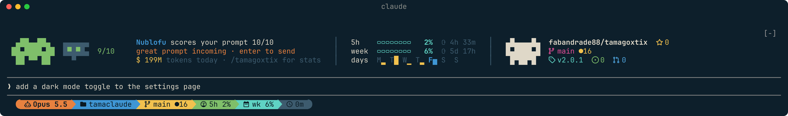
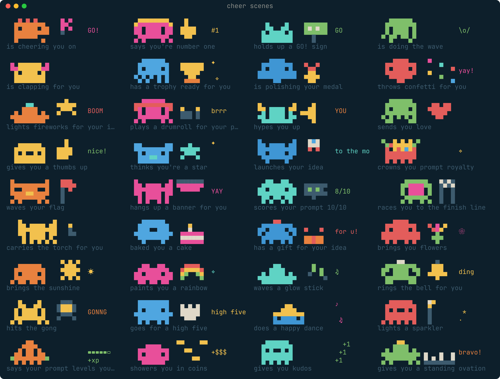

# TamaGoxtix

[](https://github.com/fabandrade88/tamagoxtix/releases)
[](LICENSE)


A tiny pixel monster that lives in your terminal while you work with Claude Code.
It acts out what Claude is doing, cheers you on while you write your prompt,
hangs out with you between turns, and keeps an eye on your token usage and your
GitHub or GitLab repo.



**38** monster bodies × **7** kinds of legs · **91** work scenes · **77** idle
scenes · **36** cheer scenes · **12** palettes · GitHub and GitLab · zero
dependencies

## Install

In a terminal:

```sh
claude plugin install tamagoxtix --marketplace fabandrade88/tamagoxtix
```

That's it: open Claude Code in any folder and the monster is there. Nothing
to choose; it works in every folder. (A session that was already open needs
`/reload-plugins` first.)

Using [herdr](https://herdr.dev)? Add its plugin too:

```sh
herdr plugin install fabandrade88/tamagoxtix/herdr
```

You need [Node.js](https://nodejs.org) 18+ and, for the icons, a
[Nerd Font](https://www.nerdfonts.com). Not sure? Type `/tamagoxtix doctor` in
Claude Code. Updating, removing, other ways to install:
[Advanced install](#advanced-install).

## Contents

- [Two pieces](#two-pieces)
- [Claude Code](#claude-code)
  - [The monster's day](#the-monsters-day): while Claude works, while you type, between turns
  - [The usage card](#the-usage-card) · [Powerline status line](#powerline-status-line) · [Palettes and the chat theme](#palettes-and-the-chat-theme)
  - [Commands](#commands) · [Where it works](#where-it-works)
- [herdr](#herdr)
- [Install](#install) · [Advanced install](#advanced-install) · [What it touches](#what-it-touches) · [Troubleshooting](#troubleshooting)
- [Development](#development) · [Changelog](#changelog)

## Two pieces

TamaGoxtix comes in two pieces that work on their own or together:

| | For | What you get |
| --- | --- | --- |
| [**Claude Code mod**](#claude-code) | everyone using Claude Code | the monster, the usage card, palettes, the powerline status line |
| [**herdr plugin**](#herdr) | people running their agents in [herdr](https://herdr.dev) | a usage popup and a status area for herdr's tab bar |

Both share one palette and one set of numbers: switch the palette on one side
and the other follows.

---

## Claude Code

### The monster's day

Every session gets its own monster, a random body, legs and color;
`/tamagoxtix reroll` draws another. What it does depends on who is busy.

#### While Claude works

The usual `✻ Thinking… (12s · ↓ 1.2k tokens)` line becomes your monster acting
out the turn, with the time and the tokens as bars.


- **The scene follows what Claude does**, a new one every 15 seconds:
  - calling the API: laptop, satellite dish, paper airplane, lighthouse…
  - thinking: chess, Rubik's cube, crystal ball, maze, abacus…
  - using tools: hammer, saw, pickaxe, welding, 3D printer, crane…
  - writing the answer: keyboard, typewriter, quill, piano, neon sign…
- **IT life**: "this is fine", deploying on a Friday, trying to exit vim, force
  pushing to main, a merge conflict, a blue screen, installing node_modules…
- **The plant floor**: talking HART to a transmitter, wiring Ethernet-APL, a
  radar level gauge, a Coriolis meter, a control valve, tuning a PID loop,
  calibrating a 4-20 mA loop, programming the PLC, a SCADA alarm…
- **Time** fills a bar every minute and adds a `●` per minute; **tokens** fill a
  bar every 10k and add a `$` per 10k.


#### While you type a prompt

As soon as you start writing, the monster drops what it was doing and roots for
you, a new cheer every 10 seconds: pom-poms, a GO! sign, fireworks, a drumroll,
a trophy, a high five, a standing ovation… with a line of encouragement under
its name. Slash commands and `!` shell lines don't count; send the prompt or
clear the box and it goes back to its own business.



#### Between turns

While Claude waits for you, the monster lives above the prompt and does its own
thing, a new scene every 40 seconds: naps, eats pizza, does the laundry, throws
a party, plays the drums, trains with a laser sword, hatches a dragon egg, plays
football, gets tired and yawns, goes to the bathroom…


Next to it, two columns (on a narrow terminal the repo column is left out
first, then usage):

- **Usage**: your 5-hour and weekly limits as bars with the time until they
  reset, this week's tokens per day and today's total.
- **Your repo**: an octocat on GitHub, a fox on GitLab (gitlab.com or your own
  instance): stars, last CI run or pipeline, branch, commits ahead/behind,
  changed files, version, open issues and pull/merge requests. Uses `gh` or
  `glab` when signed in, the public API otherwise.

On a short pane (under 3 free rows) the band shrinks to a single line: the
monster's icon, what it is up to and today's tokens. `/tamagoxtix pet off`
hides the band; `on` brings it back.

### The usage card

`/tamagoxtix` prints a card in the chat: today, the current 5-hour session and
the week, your limits, the last 14 days and today by hour.


Numbers come from Claude Code's own transcripts in `~/.claude/projects` (each API
response counted once) and the limit readings Claude Code receives (Pro and Max
plans). Nothing leaves your machine.

### Powerline status line

`/tamagoxtix statusline on` turns Claude Code's status line into oh-my-posh style
segments: model, folder, git branch, context, the 5-hour and weekly limits and
the session's time. The model leads in orange; limits turn orange and red as
they fill. `off` puts yours back.


### Palettes and the chat theme

Everything is drawn in one palette:

- **`beach`**, the default: Omarchy's Beach (ocean dusk, terracotta, palm green,
  seafoam, bougainvillea);
- **`omarchy`**: follows your active [Omarchy](https://omarchy.org) theme;
- `tokyo-night`, `catppuccin`, `gruvbox`, `nord`, `everforest`, `kanagawa`,
  `rose-pine`, `osaka-jade`, `ristretto` and `matte-black`.

Every palette has an orange to highlight with. `/tamagoxtix theme on` colors the
chat itself with the palette, mapped the way Omarchy themes Claude Code; `off`
goes back to your theme.

### Commands

`/tamagoxtix help` shows them all, with what is on:


| Command | |
| --- | --- |
| `/tamagoxtix` | The usage card |
| `/tamagoxtix help` | Every command, and which ones are on |
| `/tamagoxtix doctor` | Check Node.js, git, gh, glab and the font, with how to install what's missing; what the band has room for |
| `/tamagoxtix palette [name]` | List the palettes, or switch |
| `/tamagoxtix theme on` / `off` | Color the chat with the palette |
| `/tamagoxtix statusline on` / `off` | The powerline status line |
| `/tamagoxtix icons nerd` / `plain` | Nerd Font icons and arrows, or plain symbols any font draws |
| `/tamagoxtix pet on` / `off` | Show or hide the monster above the prompt |
| `/tamagoxtix reroll` | A new monster |

### Where it works

| | |
| --- | --- |
| Claude Code in a terminal (also inside herdr) | everything |
| Claude Code desktop app (local sessions) | the monster, the band above the prompt and the cards; no status line (the app doesn't show one) |
| VS Code / JetBrains extensions | the `/tamagoxtix` commands as text |
| claude.ai (web, mobile) | not supported: mods run in Claude Code only |

---

## herdr

For [herdr](https://herdr.dev), the terminal workspace for running many agents.

### Usage popup

`tamagoxtix.stats` opens a popup with the same numbers as the usage card:
today, session, week, the limits, the last 14 days and today by hour. `p`
switches the palette, `r` refreshes, `q` closes.


### The tamagoxtix look for herdr

`tamagoxtix.theme-install` adds a status area right of the tabs (git branch,
tokens today, the 5-hour and weekly limits, a clock) with Nerd Font icons and
powerline separators.

- **Colors from herdr's theme** (the default, `theme-follow-herdr`): nothing is
  painted, so switching the theme in herdr recolors everything, Spaces and
  Agents included.
- **Colors from the palette** (`theme-follow-palette`): herdr's colors and the
  Space and Agent rows in the tamagoxtix palette, Spaces in its orange. With the
  `omarchy` palette, an Omarchy hook repaints it on every theme change.

herdr has no background colors, so the arrows are separators rather than filled
segments (the filled ones live in Claude Code's status line).
`tamagoxtix.theme-uninstall` restores your `config.toml` exactly; keys of yours
that would clash are commented out, never deleted.

### Actions

Run them with `herdr plugin action invoke <action>` or bind them to keys.

| Action | |
| --- | --- |
| `tamagoxtix.stats` | The usage popup |
| `tamagoxtix.theme-install` / `theme-uninstall` | The tamagoxtix look |
| `tamagoxtix.theme-follow-herdr` / `theme-follow-palette` | Its colors from herdr's theme or from the palette |
| `tamagoxtix.palette-next` | Next palette |
| `tamagoxtix.palette-refresh` | Apply the palette again (the Omarchy hook runs it) |
| `tamagoxtix.sidebar-install` / `sidebar-uninstall` | Critter icons in the sidebar instead of the state dots (optional) |
| `tamagoxtix.icon` / `tamagoxtix.reroll` | Pick or reroll the focused agent's icon |

Bind the popup to a key in herdr's `config.toml`:

```toml
[[keys.command]]
key = "prefix+m"
type = "plugin_action"
command = "tamagoxtix.stats"
description = "token usage"
```

---

## Advanced install

**Requirements:** [Node.js](https://nodejs.org) 18+; Claude Code 2.1.300+ for the
mod; [herdr](https://herdr.dev) 0.9.0+ for the plugin; a
[Nerd Font](https://www.nerdfonts.com) (Omarchy ships one) for the icons and the
powerline arrows, or `/tamagoxtix icons plain` for symbols any font draws.
Nothing is downloaded or built at install time, and nothing is installed for
you: `/tamagoxtix doctor` tells you what is missing and how to get it.

The Claude Code side is built on Claude Code's function hooks (mods), an
early-access API that can change between Claude Code releases.

### Claude Code mod

| | |
| --- | --- |
| Install from a shell | `claude plugin install tamagoxtix --marketplace fabandrade88/tamagoxtix` (every folder) |
| Install inside Claude Code | `/plugin install tamagoxtix --marketplace fabandrade88/tamagoxtix`, pick **user** when asked, then `/reload-plugins` |
| Update | `claude plugin update tamagoxtix`, then `/reload-plugins` |
| Remove | `/tamagoxtix statusline off`, `/tamagoxtix theme off`, then `claude plugin uninstall tamagoxtix` |
| Without a marketplace | clone the repo and run `claude --plugin-dir ./tamagoxtix/claude` |

- **Scopes**: `user` (the shell command's default) works in every folder;
  `project` and `local` only in the folder you installed from, so the monster
  seems to vanish everywhere else.
- **Installed twice?** `claude plugin list` shows each install with its scope.
  Keep the `user` one and, from the folder the other was installed in, run
  `claude plugin uninstall tamagoxtix --scope project` (or `--scope local`).
- **`0 hooks`** in `/reload-plugins` is normal: that count leaves out mods.

### herdr plugin

| | |
| --- | --- |
| Install | `herdr plugin install fabandrade88/tamagoxtix/herdr` |
| Update | `herdr plugin update tamagoxtix` |
| Remove | `herdr plugin action invoke tamagoxtix.theme-uninstall`, then `herdr plugin uninstall tamagoxtix` |

### Coming from tamaclaude?

TamaGoxtix is tamaclaude's new name (2.0). Install TamaGoxtix as above, then
remove tamaclaude; your palette, monster and toggles carry over on their own:

```
claude plugin uninstall tamaclaude
herdr plugin action invoke tamaclaude.theme-uninstall   # before removing it from herdr
herdr plugin uninstall tamaclaude
```

## What it touches

- **Runs** `node`, `git`, and `gh` / `glab` when installed (plus `herdr` inside
  herdr), always with an argument list, never through a shell.
- **Network**: only the public API of your project's forge (`api.github.com` or
  your GitLab host), and only when `gh` / `glab` aren't signed in. No telemetry.
- **Reads** Claude Code's transcripts (token counts and timestamps only), its
  `settings.json`, the Omarchy theme colors and your project's version.
- **Writes** its own `~/.config/tamagoxtix/config.json` and
  `~/.local/state/tamagoxtix/`. Only when you ask: the `statusLine` and `theme`
  keys of Claude Code's `settings.json` (never a file that isn't valid JSON, and
  a copy is kept the first time as `settings.json.tamagoxtix-backup`), the chat
  theme file, and herdr's `config.toml` (checked with `herdr config check`,
  restored on uninstall).

## Troubleshooting

### The monster doesn't show up

1. **Does `/tamagoxtix` exist?** Type it. If Claude Code doesn't know the
   command, the mod isn't loaded in this session: run `/reload-plugins`.
2. **Is it enabled for you?** `claude plugin list` should show
   `tamagoxtix@tamagoxtix`, `Scope: user`, `✔ enabled`. A `project` or `local`
   scope only works in the folder it was installed from (see
   [Advanced install](#claude-code-mod)).
3. **Still nothing after reopening?** Run `claude --debug`, then look for
   `tamagoxtix` in the debug log: a hook that was skipped says why there.

The band above the prompt needs 3 free rows. With 1 or 2 (a short herdr pane,
a long draft) it shrinks to one line, and it steps aside while Claude works or
a survey is shown. `/tamagoxtix doctor` explains this and says which columns
fit your terminal's width.

### Other problems

- **Something new is missing, or a command looks old**: the session runs the
  version it loaded; run `/reload-plugins`.
- **Squares instead of icons or arrows**: your terminal font has no Nerd Font
  glyphs. Pick a [Nerd Font](https://www.nerdfonts.com) in your terminal, or run
  `/tamagoxtix icons plain`.
- **No usage numbers**: the band says so when Node.js is missing;
  `/tamagoxtix doctor` checks everything TamaGoxtix needs.
- **No limits in the bars**: Claude Code reports them on Pro and Max plans, after
  the session's first response.
- **herdr's colors don't change with its theme**: the look follows the palette;
  run `herdr plugin action invoke tamagoxtix.theme-follow-herdr`.

## Development

```sh
claude --plugin-dir ./claude      # run the mod from this checkout
herdr plugin link ./herdr         # run the herdr plugin from this checkout
npm run sync                      # after editing shared/ or the version in package.json:
                                  # copy shared/ into both packages, and the version into
                                  # plugin.json, marketplace.json and herdr-plugin.toml
npm test                          # everything below
npm run test:unit                 # node --test, and the mod's tests (tests/mod) in a copy of claude/
npm run test:security             # argv-only commands, known APIs and paths, no secrets
npm run test:perf                 # frame, usage-reading and hook budgets
```

| Folder | |
| --- | --- |
| `claude/` | the Claude Code mod: `hooks/register.tsx` (hooks and commands), `hooks/spinner.tsx` and `hooks/idle.tsx` (the animated surfaces), `scripts/statusline.mjs` |
| `herdr/` | the herdr plugin: `herdr-plugin.toml` and `src/` |
| `shared/` | monsters, scenes (`scenes.mjs`, `scenes-more.mjs`, `scenes-cheer.mjs`), palettes, powerline, forge parsing and the usage reader |
| `scripts/` | shared-copy sync, security check, benchmark, screenshots |

Each package carries its own copy of `shared/` because Claude Code and herdr
install only their own folder. Screenshots are real captures
(`herdr pane read --ansi`) rendered with `scripts/ansi-to-svg.mjs`;
`scripts/gallery.mjs idle|work|cheer` draws the scene grids.

## Changelog

### 2.1.4

- Clears the last blocking findings of the Claude plugin directory: no
  variable or parameter is named `h` in the `.tsx` files (JSX compiles to
  `h(...)`), and every `$.noun.method(...)` call stands on its own, never
  inside parentheses, a ternary or another call; the GitHub-or-GitLab choice
  moved to its own function, and `gh` now hands back plain JSON that the mod
  reads itself (no `--jq` programs in the command); one `publicApi` function
  reads both forges' public APIs and parses the JSON itself; the surface
  modules each draw their own scene rows (no `art.tsx` import).
- The mod's files moved up to the plugin folder (`register.tsx`, `spinner.tsx`,
  `idle.tsx`, `lib/`), so a surface module's path reads the same from the hooks
  module and from the plugin's root; `hooks/hooks.json` points at
  `../register.tsx`.
- No parameter or variable shares a name with a hook's `on` or `next`
  (`setStatusline` and `setChatTheme` take `enable`).
- Nothing changes in how it works.

### 2.1.3

- Passes the Claude plugin directory's mod checks: every command, file path and
  web address is written out in full at its call, no helper is handed `$` from
  inside another function, the surface modules import `./art.tsx` by its full
  name, the time comes from `$.clock.now()` and GitLab paths are encoded
  without the browser's `encodeURIComponent`.
- The plugin's README names each file it writes, says plainly that it edits
  Claude Code's settings file (only on `/tamagoxtix statusline` and `theme`),
  lists the environment variables it reads, and says that `gh` and `glab` use
  their own sign-in.
- Fixed a type error in `readJson`. Nothing changes in how it works.

### 2.1.2

- Ready for the Claude plugin directory: the mod's calls are written the way
  the directory reads them, a listing icon, and the plugin's README says
  exactly which programs it runs, which hosts it contacts, what it reads and
  writes, and what each hook does.
- The mod's tests moved to `tests/mod`, out of the published plugin folder.
- Nothing changes in how it works, except that a draft cleared with Ctrl+C keeps
  the cheer going until the next key or the next prompt.

### 2.1.1

- **Install in one line**: `claude plugin install tamagoxtix --marketplace
  fabandrade88/tamagoxtix` from a shell, nothing to choose. Everything else
  (scopes, updating, removing, a second install, `0 hooks`) is in Advanced
  install, and a checklist covers the monster not showing up.
- **One-line band**: with under 3 free rows above the prompt (a short herdr
  pane, a long draft) the monster shrinks to one line instead of vanishing.
- **`/tamagoxtix doctor`** explains when the band hides or shrinks and which
  columns fit your terminal's width.
- **Lighter**: git is asked once per folder that has no repository, not on every
  turn (again after 10 minutes); the Omarchy theme file is read only for the
  `omarchy` palette and only where it exists; herdr is asked for the monster's
  seed once per session; the usage cache keeps only the last 14 days, with
  shorter keys (less than half the size).
- `npm run sync` carries the version from `package.json` into every manifest,
  and `npm test` fails when one is out of step.

### 2.1.0

- **Cheer scenes**: 36 scenes where the monster cheers you on while you type a
  prompt (pom-poms, fireworks, a trophy, a high five…), a new one every 10
  seconds, with a line of encouragement under its name.
- README renewed: quick start, contents, the monster's day in one place, what
  TamaGoxtix touches.

### 2.0.1

- `/tamagoxtix doctor`: checks Node.js, git, `gh`, `glab` and the font, and says
  how to install what's missing.
- `/tamagoxtix icons plain`: symbols every font draws, for the status line, the
  repo column and the herdr bar, when there is no Nerd Font.
- Without Node.js the idle band says how to get the usage numbers instead of
  leaving them blank.

### 2.0.0

- **tamaclaude is now TamaGoxtix**: the repository, the Claude Code mod
  (`/tamagoxtix`), the herdr plugin (`tamagoxtix.*`) and the settings folders.
  An installed tamaclaude carries over: its choices, the status line and the
  chat theme move to the new names the first time TamaGoxtix runs. Install
  TamaGoxtix and uninstall tamaclaude (see Install).

### 1.1.1

- Safer changes to Claude Code's `settings.json` (`statusline on|off`,
  `theme on|off`): a file that isn't valid JSON is left alone instead of being
  replaced, the first change keeps a copy (`settings.json.tamagoxtix-backup`),
  only tamagoxtix's own keys change, and the result is read back and restored
  if anything went wrong.
- The chat theme file is written only while the chat uses it.
- `/tamagoxtix help` lists what to turn off before uninstalling.

### 1.1.0

- Claude Code: `/tamagoxtix help`; the powerline status line; the `beach`
  palette as tamagoxtix's own and an orange highlight in every palette; the
  monster, the band and the cards in the desktop app too; GitLab with a pixel
  fox; a compact usage card; 77 idle and 91 work scenes (a party, instruments,
  IT memes, industrial instrumentation and automation).
- herdr: the tamagoxtix look (tab-bar status area), following herdr's theme by
  default or the palette, with an Omarchy hook.
- Unit, security and performance checks; text from git remotes is sanitized.

### 1.0.0

First release: the animated monster spinner, the idle band with usage limits and
a GitHub column, the usage card, palettes and a chat theme; the herdr usage
popup, palettes and optional sidebar icons.

## License

MIT
